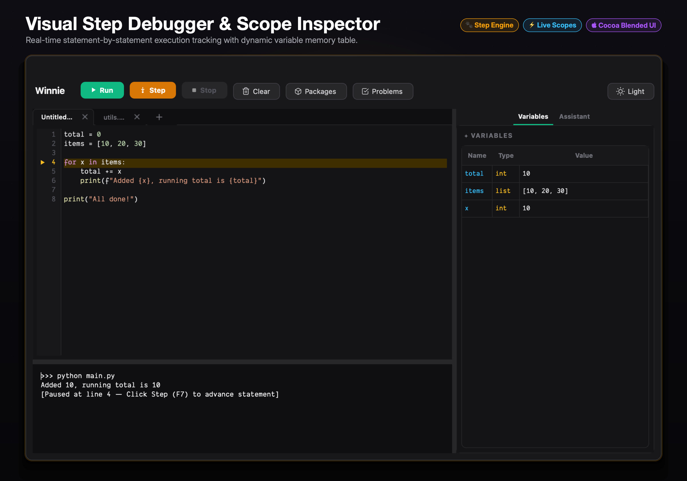
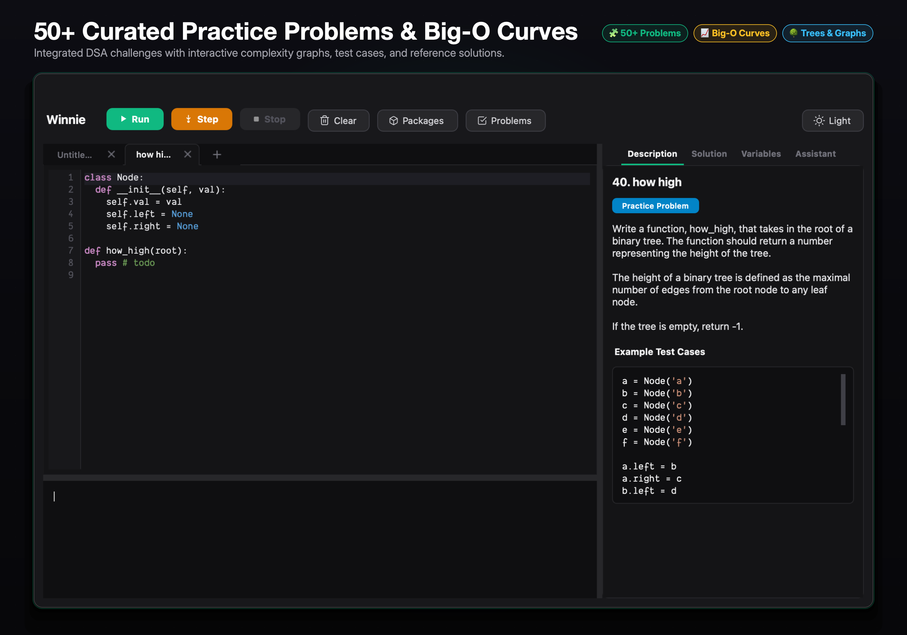
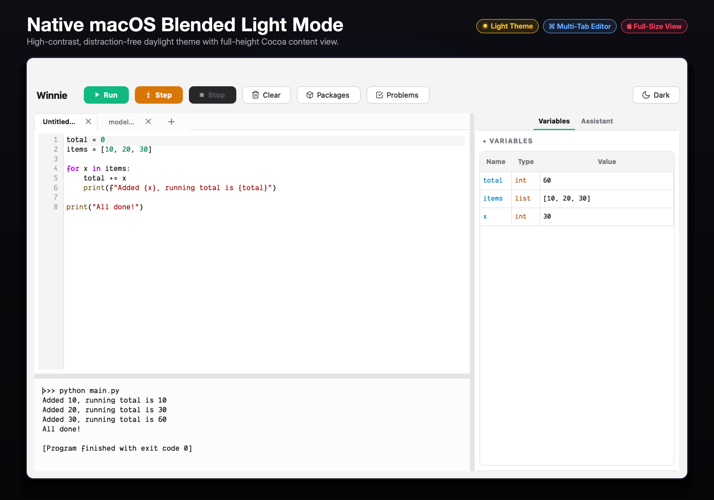
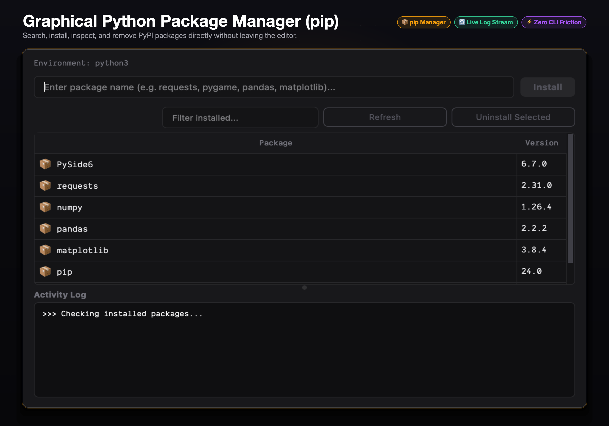

<div align="center">
  
  <h1>Winnie</h1>
  <p><strong>A lightweight, beginner-friendly Python Integrated Development Environment (IDE) for macOS</strong></p>

  <p>
    
    
    
    
    
  </p>
</div>

Winnie implements a dual-process execution model inspired by educational environments like Thonny. It provides intuitive visual debugging, scope inspection, 50+ built-in practice problems, multi-tab editing, and an interactive shell within a clean, modern macOS interface.

---

## Interface & Previews

### Visual Step Debugger & Scope Inspector
Statement-by-statement runtime execution tracking with real-time instruction pointer highlights and dynamic variable inspection table.


### 50+ Curated Practice Problems & Big-O Complexity Curves
Interactive data structure challenges (Graphs, Trees, Linked Lists, Recursion, Sliding Window) with animated Big-O curves and reference solutions.


### Native macOS Blended Light Mode
High-contrast daylight theme with full-height Cocoa content view and seamless title bar blending.


### Graphical Python Package Manager (pip)
Search, install, inspect, and remove PyPI packages directly without touching the terminal.


---

## Architectural Highlights

- **Visual Step Debugger**: Integrates directly with Python's runtime trace facility (`sys.settrace`) to provide statement-by-statement execution. Highlights the active instruction pointer in real-time and updates local/global scopes synchronously.
- **Multi-Tab Code Editor**: Full multi-file editing support with sleek tab navigation, drag re-ordering, inline `+` tab creation, and monochromatic close buttons.
- **50+ Practice Problems**: Built-in coding problems spanning Basics, Recursion, Linked Lists, Binary Trees, Hash Maps, Graphs, and Sliding Window, complete with interactive Big-O complexity charts and reference solutions.
- **Beginner Error Assistant**: Automatic traceback analysis engine. Intercepts runtime exceptions, highlights offending source lines, and translates technical errors into plain-English explanations with actionable fix suggestions.
- **Graphical Package Manager**: Integrated pip GUI dialog for searching, installing, and uninstalling PyPI packages directly into the active Python environment with real-time log streaming.
- **Process-Isolated Execution Engine**: User code executes within an independent worker process managed via `QProcess`. Infinite loops, uncaught exceptions, and forced exits (`sys.exit()`) do not compromise the IDE interface or runtime state.
- **Interactive Standard Streams**: Bidirectional, unbuffered communication channel between the GUI shell and the running process. Fully supports interactive `input()` calls with input boundary protection.
- **Runtime Scope Inspector**: Real-time inspection table displaying variable identifiers, dynamic types, and serialized string representations after each statement or script execution.
- **Editor & Formatting**: Custom code editor featuring line numbers, active line indicators, syntax highlighting (with regular, upright comments), and PEP 8 automatic indentation.
- **Native macOS System Integration**: Blended title bar (`NSWindowStyleMaskFullSizeContentView`), WindowServer hardware-accelerated title bar dragging, native menu bar, and custom warm Honey & Amber Retina application icon.

---

## Keyboard Shortcuts

| Shortcut | Description |
| :--- | :--- |
| `Cmd + Return` | Execute current script |
| `F7` / `Cmd + Option + S` | Step to next line (Visual Debugger) |
| `Cmd + .` / `Escape` | Terminate running process |
| `Cmd + K` | Clear console output and scope table |
| `Cmd + Shift + P` | Open graphical Package Manager (pip) |
| `Cmd + T` / `Cmd + Shift + T` | Toggle Dark / Light theme |
| `Cmd + J` | Toggle console terminal visibility |
| `Cmd + L` | Toggle variables inspector visibility |
| `Cmd + +` | Increase font size across all panes |
| `Cmd + -` | Decrease font size across all panes |
| `Cmd + 0` | Reset font size to default (13pt) |
| `Cmd + S` | Save current file |
| `Cmd + Shift + S` | Save current file as |
| `Cmd + O` | Open existing Python file |
| `Cmd + N` | Create new file |

---

## Installation and Execution

### System Requirements
- macOS 12.0 (Monterey) or later (Apple Silicon or Intel)
- Python 3.10 or higher

### Running from Source

```bash
# 1. Clone the repository
git clone https://github.com/nileshhazra/winnie.git
cd winnie

# 2. Create and activate a virtual environment
python3 -m venv .venv
source .venv/bin/activate

# 3. Install dependencies
pip install -r requirements.txt

# 4. Launch Winnie
python main.py
```

---

## Building the Standalone macOS Application

Winnie can be packaged into a native macOS `.app` bundle containing high-DPI application icons and bundled runner scripts:

```bash
# Compile Winnie.app using the automated build script
bash build_app.sh

# Reveal the compiled bundle in Finder
open dist
```

The resulting `dist/Winnie.app` can be deployed directly to `/Applications`.

### First Launch Notice (macOS Gatekeeper)

Winnie is free, open-source software built from source on GitHub Actions. Because it is not signed with an Apple Developer ID certificate ($99/year), macOS Gatekeeper displays a standard verification prompt on initial launch after downloading from GitHub Releases:

> *"Apple could not verify 'Winnie' is free of malware..."*

To launch the application:
1. **Via Terminal (Recommended)**: Remove the quarantine flag attached by the browser:
   ```bash
   xattr -cr /Applications/Winnie.app
   ```
2. **Via System Settings**: Go to **System Settings** > **Privacy & Security**, scroll to the **Security** section, and click **Open Anyway**.

---

## Continuous Integration and Automated Releases

The repository includes a GitHub Actions workflow (`.github/workflows/release.yml`) configured for automated macOS application builds and distribution:

1. When a version tag matching `v*` (e.g., `v1.0.0`) is pushed to GitHub, a macOS runner automatically checks out the codebase.
2. Dependencies are provisioned and `build_app.sh` compiles the standalone `Winnie.app` bundle.
3. The bundle is compressed into a `.zip` archive and published as an asset under GitHub Releases with generated changelogs.

### Creating a Release

```bash
# Tag the current commit and push to trigger automated deployment
git tag v1.0.0
git push origin v1.0.0
```

---

## License

This project is licensed under the MIT License. See the [LICENSE](LICENSE) file for complete details.
